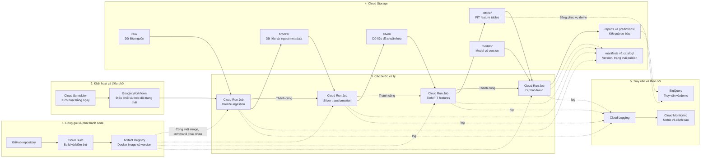
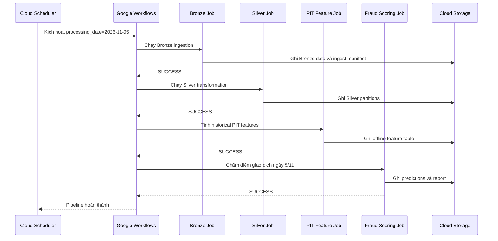
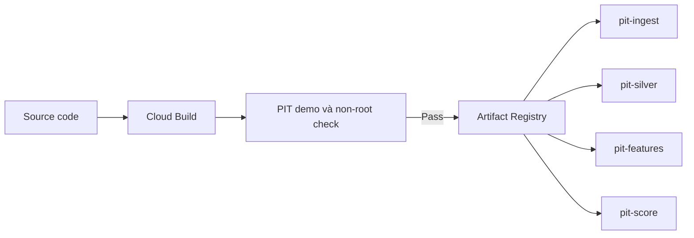
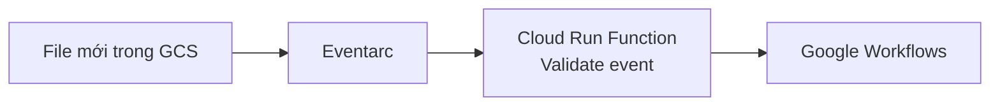
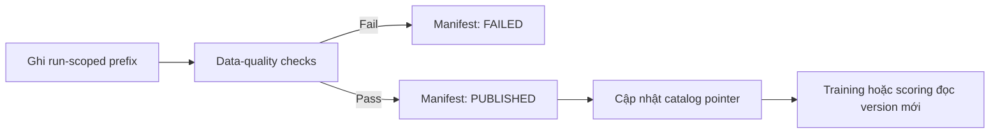

# KIẾN TRÚC PIPELINE POINT-IN-TIME FEATURE STORE TRÊN GOOGLE CLOUD

## 1. Mục đích tài liệu

Tài liệu này mô tả kiến trúc dự kiến khi đưa pipeline Point-in-Time Correct Feature Store từ
máy local lên Google Cloud. Mục tiêu là trả lời bốn câu hỏi:

1. Code được đóng gói và phát hành như thế nào?
2. Dữ liệu đi qua các bước nào?
3. Dịch vụ Google Cloud nào chịu trách nhiệm cho từng bước?
4. Phần nào đã hoàn thành và phần nào vẫn đang được xây dựng?

Pipeline mang tính **batch**: mỗi ngày được kích hoạt một lần, xử lý dữ liệu mới rồi dừng. Các
Cloud Run Jobs không chạy liên tục khi không có dữ liệu cần xử lý.

## 2. Sơ đồ kiến trúc tổng thể



## 3. Luồng chạy hằng ngày

Ví dụ ngày 6/11, hệ thống nhận được dữ liệu giao dịch của ngày 5/11:



Nếu một bước thất bại, bước sau không được chạy. Ví dụ Silver thất bại:

```text
Bronze:      SUCCESS
Silver:      FAILED
PIT Feature: KHÔNG CHẠY
Scoring:     KHÔNG CHẠY
```

Workflows lưu trạng thái để xác định chính xác pipeline dừng ở đâu và bước nào cần chạy lại.

## 4. Một Docker image, nhiều Cloud Run Jobs

Docker không có nghĩa là toàn bộ pipeline bị gom thành một bước. Một image chứa code và thư
viện chung; mỗi Cloud Run Job gọi một command khác nhau.

| Cloud Run Job | Command dự kiến | Trách nhiệm |
|---|---|---|
| `pit-ingest` | `ingest-bronze` | Đưa raw data vào Bronze và thêm ingest metadata |
| `pit-silver` | `build-silver` | Chuẩn hóa kiểu, join identity, tạo event time và entity IDs |
| `pit-features` | `materialize-offline-features` | Tính historical features đúng theo thời điểm |
| `pit-score` | scoring command | Dùng model có version để dự báo giao dịch mới |

Luồng triển khai image:



## 5. Vai trò từng dịch vụ

| Dịch vụ | Vai trò | Có chạy liên tục không? |
|---|---|---|
| Cloud Scheduler | Kích hoạt workflow theo lịch | Không |
| Google Workflows | Điều phối thứ tự, retry và failure path | Chỉ khi có execution |
| Cloud Run Jobs | Chạy từng batch Bronze/Silver/PIT/Scoring | Chạy xong rồi dừng |
| Cloud Storage | Lưu dữ liệu, model, report và manifest | Là storage, không phải compute |
| Artifact Registry | Lưu Docker image có version | Là storage, không phải compute |
| Cloud Build | Build và kiểm tra image | Chỉ khi phát hành phiên bản mới |
| Cloud Logging | Thu log của build và jobs | Nhận log khi có hoạt động |
| Cloud Monitoring | Metric, dashboard và cảnh báo | Dịch vụ quản lý |
| BigQuery | Truy vấn kết quả phục vụ demo/báo cáo | Chỉ tính phí theo cách sử dụng |

## 6. Vì sao không dùng Cloud Function cho toàn bộ pipeline?

Cloud Function phù hợp với logic nhỏ và phản ứng theo sự kiện, ví dụ:

```text
File mới được upload
→ kiểm tra tên file
→ gọi Workflow
```

Bronze, Silver và PIT materialization là batch processing nặng: đọc file lớn, join, tính rolling
features, ghi nhiều Parquet partitions và có thể cần nhiều RAM/thời gian. Cloud Run Jobs phù hợp
hơn vì job chạy đến khi hoàn thành, có cấu hình CPU/RAM/timeout/retry rõ ràng và dùng trực tiếp
Docker image đã kiểm thử.

Cloud Function có thể được bổ sung sau này làm trigger theo sự kiện:



Với MVP cập nhật theo ngày, `Cloud Scheduler → Workflows` đơn giản và dễ kiểm soát hơn.

## 7. Publish dữ liệu an toàn

Cloud Storage FUSE không phải filesystem POSIX đầy đủ. Pipeline không coi việc đổi tên cả thư
mục là thao tác publish nguyên tử. Mỗi lần chạy sẽ ghi vào prefix riêng:

```text
silver/runs/<run_id>/...
offline/runs/<run_id>/...
```

Sau khi kiểm tra row count, schema, checksum và PIT quality thành công, pipeline mới cập nhật
manifest/catalog pointer để consumer nhìn thấy phiên bản mới:



## 8. Trạng thái triển khai hiện tại

### Đã hoàn thành

- [x] Cloud project, billing budget và region.
- [x] Cloud configuration và structured logging.
- [x] Docker runtime/test image Linux amd64, non-root.
- [x] Cloud Build dùng custom builder service account.
- [x] Artifact Registry dùng immutable tags.
- [x] Private Cloud Storage bucket, versioning, soft delete và lifecycle.
- [x] Runtime service account có quyền bucket tối thiểu.
- [x] Cloud Run job chạy future-event invariance demo thành công.
- [x] Cloud Run non-root container mount, ghi và đọc Cloud Storage thành công.

### Chưa hoàn thành

- [ ] Terraform/import toàn bộ hạ tầng đã tạo thủ công.
- [ ] Phát hành image bằng Git commit SHA.
- [ ] Cấu hình source paths dành cho cloud.
- [ ] Chạy Bronze và Silver trên dữ liệu thật ở cloud.
- [ ] Chạy full PIT materialization và đo CPU/RAM/runtime/cost.
- [ ] Run-scoped prefix, manifest state và catalog pointer an toàn.
- [ ] Workflows điều phối pipeline.
- [ ] Cloud Scheduler kích hoạt hằng ngày.
- [ ] Scoring job, BigQuery serving và monitoring dashboard.
- [ ] Backfill orchestration trên cloud.

## 9. Bằng chứng cloud hiện có

| Thành phần | Bằng chứng |
|---|---|
| Cloud Build | `583532b6-d303-403b-ae86-f5018a0bb027`, trạng thái `SUCCESS`, `2m34s` |
| Published image | Digest `sha256:007eb0a769c083efa48b45a6ffad4e2649c8be1b58959530d65e081895efd00d` |
| Cloud Run PIT demo | Execution `pit-features-5c8xt`, `1/1` task hoàn thành |
| Storage mount smoke test | Execution `pit-storage-smoke-w2fps`, ghi/đọc object thành công |

Job và object tạm của storage smoke test đã được xóa sau khi xác minh. Job `pit-features` vẫn
tồn tại nhưng không chạy liên tục; nó chỉ dùng compute khi được execute.
